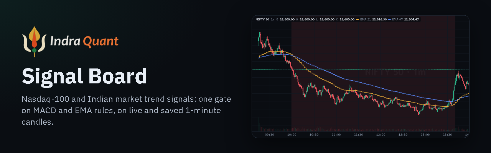

# Indra Quant Signal Board

Live Nasdaq-100 trend signals from Hyperliquid's 24/7 stock perps.

**Open it: https://shyameet.github.io/nasdaq-signal-board/**

Each series gets a gate, checked every second on the bars still forming:

| Gate | Condition |
|---|---|
| LONG | 5m, 9m and 11m MACD all above 0, and the 3m EMA 21 above the EMA 47 |
| SHORT | all three below 0, and the EMA 21 below the EMA 47 |
| NO TRADE | anything else |

The **Stocks** page runs the gate on the stocks you pick: the ten largest Nasdaq-100 stocks that trade on Hyperliquid by default, plus AVGO, TSM and INTC to add, any 1 to 13 of them. Each picked stock gets its own gate on its own candles, and the page's gate is LONG only when every picked stock is LONG, SHORT only when every one is SHORT, NO TRADE otherwise. The chart is the picked stocks combined with equal weights (1000 = the 10/05/2026 close; each minute 1000 x the average of the stocks' moves since then). Its candles: each minute's close as above, open = the previous close, volume = the stocks' dollar volume; with the
gate's zones, the composite's 3m EMA 21/47, and the Entry (2m/3m) and Trend (1m/5m/7m/9m/11m/15m) MACD panes. The
The **Nasdaq** tab shows it beside the Nasdaq-100 perp `xyz:XYZ100` (`replay.html`) or beside CME MNQ (`mnq.html`), picked in the tab's XYZ100 / MNQ switch.

Everything runs in your browser. The page loads two days of 1-minute candles from Hyperliquid's public API,
then follows its live candle stream. There is no server and no account; drawings and settings stay in your
browser.

For information only, not investment advice. An independent project, not affiliated with Nasdaq, Inc.,
Hyperliquid or TradingView.

| File | What it is |
|---|---|
| `index.html` | the Stocks page |
| `replay.html` | the Replay page: one UTC day at a time, your stocks' composite beside XYZ100, the gate, the 2m/3m entry signals with per-trend / gap / one-trend-per-day boxes, whole-day view or candle-by-candle playback; reads `data/1m/` (the VPS's daily archive) and Hyperliquid's last ~3.5 days |
| `india-replay.html` | the India Replay page: one Indian trading day at a time from `data/india/1m/` (Dhan 1-minute candles saved by the VPS from 15 Oct 2026); the Nifty setup (NIFTY 50 + GIFT NIFTY trend, then RELIANCE syncs as the odd man out, then its 2m/3m entry) and the Bank Nifty setup (NIFTY BANK, then HDFC BANK), candles aligned to each session's open as on TradingView |
| `engine.js` | the signal calculation |
| `macd.js` | the Trend and Entry MACD panes, their on/off switches and shading, and the day separators (both pages) |
| `basket.json` | the stocks on offer (the default 10 and the extra 3) and their reference prices |
| `lightweight-charts.js` | TradingView Lightweight Charts™ 4.2.3 |
| `brand/` | the official Indra Quant lockup, emblem and icons (copied as is from the brand kit, `rdx-quant-lab/branding/`), the app manifest and the link-preview pictures |
| `404.html` | the page for addresses that don't exist |

Charts: [TradingView Lightweight Charts™](https://www.tradingview.com/lightweight-charts/),
Copyright (c) 2025 TradingView, Inc., Apache License 2.0.
